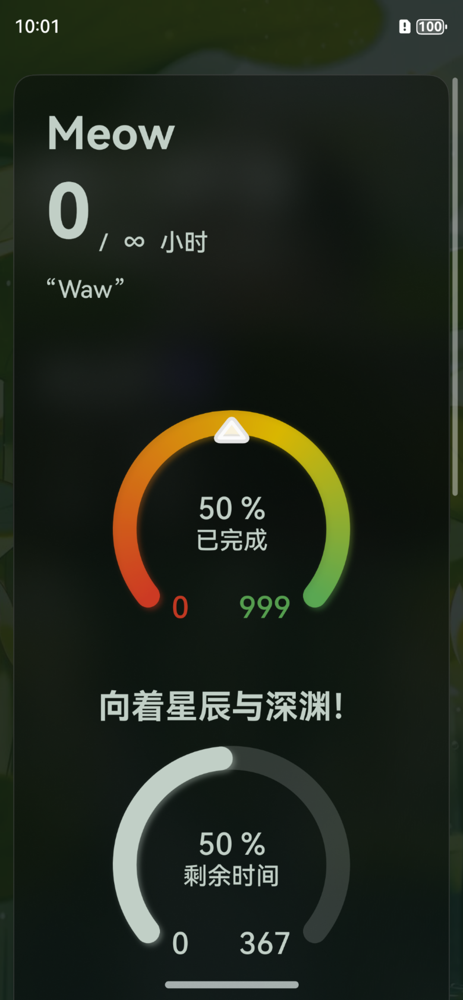

# 寸进 · CUNJIN

> 日有寸进 / *An inch a day.*

基于 HarmonyOS NEXT（API 12+，ArkTS / ArkUI）构建的个人进度记录应用。

## 这是什么？

**寸进** 是一个「一次只做一件事」的记录与计划工具：创建一张计划卡片，设定完成期限与目标时长，然后每天打卡、写一句当天的话。剩下的交给它——卡片会自己算出进度、剩余时间与每日所需，数据看板把它们整理成能看懂的形状（赞美 ArkUI！）。

名字来自「日有寸进」：不承诺爆发，只承诺累积。一寸一寸，也算数。

## 功能

- **计划卡片**：名称、描述、完成期限（或「直到永远」）、目标时长（或「止于至善」）、卡片视觉长度
- **每日打卡**：记录当天投入的小时数，并为每一天写一句备注
- **计时**：在卡片详情里直接开始/结束一次计时，结束后自动计入当天
- **进度环**：已完成 / 剩余时间双环，天数与百分比实时计算
- **管理**：置顶、归档（半透明显示，可一键隐藏）、删除
- **统计看板**：今日 / 近 7 天 / 连续天数 / 累计，以及逐日打卡热力网格
- **外观自定义**：纯色或图片背景、模糊半径、明暗两套配色、最小卡片宽度
- **备份**：整库导出为 JSON，导入前自动另存一份现场

## 截图

> 截图为改名前的界面，标题仍是旧名，重跑一次预览即可更新。




## 工程结构

```
AppScope/                     应用级配置与图标
entry/src/main/ets/
├─ pages/Index.ets            单页入口：布局、状态、事件
├─ components/                卡片、进度环、看板、各类面板
│  └─ atoms/                  标题、说明、按钮、文本框等原子组件
├─ model/                     纯数据层：模型、编解码、查询、统计、时间格式化
├─ repository/                持久化：KV 封装、唯一写入入口、备份文件
├─ design/                    共享动效参数
└─ entryability/              应用入口与备份扩展
```

`model/` 与 `repository/` 中的大部分逻辑是纯函数，不依赖 `@kit.*`，因此可以在本地单元测试里直接跑（`entry/src/test`）。

## 数据

本地 KV 存储，键为 `cards_v2` / `settings_v2` / `work_state_v2`，由统一的对象模型序列化。读取时一律经过 `normalize*` 兜底：字段缺失补默认值、长度不一致自动对齐，所以旧数据不需要迁移代码即可读入。

备份文件以 `cunjin-next-backup` 作为格式标识，文件名形如 `cunjin-backup-*.json`；导入前会自动另存一份现场。

## 构建

用 DevEco Studio 打开本目录，或在已配置 hvigor 的环境下执行构建；`compatibleSdkVersion` 为 `5.0.0(12)`。

## 许可

见 [LICENSE](LICENSE)。
